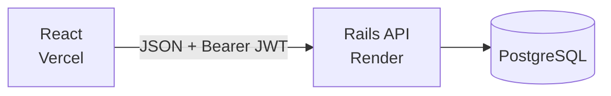
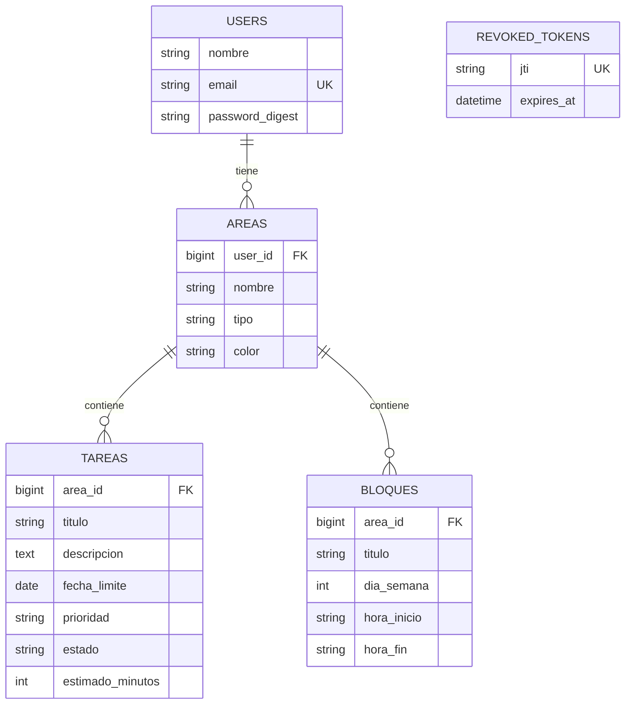

# Foco — API (Ruby on Rails)

> API REST JSON de Foco, el organizador de estudios y emprendimiento.

Este repositorio es el **backend**. El frontend (React) está en
[`foco-web`](https://github.com/Bryan4631/foco-web).

## 1. Nombre del proyecto

**Foco** — organizador de estudios y emprendimiento.

## 2. Descripción

API que permite a cada usuario registrarse, iniciar y cerrar sesión, y gestionar sus **áreas**,
**tareas** y **bloques de horario**. Cada usuario solo accede a sus propios datos.

## 3. Problema que resuelve

Quien estudia y a la vez trabaja o emprende reparte sus obligaciones entre varias herramientas
y pierde la visión de su semana. Foco centraliza horario fijo y tareas pendientes en una sola
aplicación, con datos propios y protegidos.

## 4. Stack tecnológico

| Capa | Tecnología |
| --- | --- |
| Lenguaje / framework | Ruby 3.3, Ruby on Rails 8.1 (modo API) |
| Base de datos | PostgreSQL |
| Autenticación | `has_secure_password` (bcrypt) + JWT (`jwt`) |
| CORS | `rack-cors` |
| Seguridad / calidad | brakeman, bundler-audit, rubocop-rails-omakase |
| Despliegue | Render (Dockerfile incluido) |
| Frontend | React + Vite (repo `foco-web`, en Vercel) |

## 5. Arquitectura



- **Rutas versionadas** bajo `/api/v1`, con `resources` RESTful.
- `BaseController` exige un JWT válido (`authenticate_user!`) en todos los recursos protegidos.
- **Errores centralizados** con `rescue_from` en `ApplicationController`
  (404 recurso no encontrado, 422 validación, 400 parámetro faltante, 401 no autorizado).
- **Logout real:** el `jti` del token se guarda en `revoked_tokens` y deja de servir
  aunque no haya expirado.
- `password_digest` nunca se expone en las respuestas.
- Los tokens expiran a las **24 horas**.

### Endpoints

| Método | Ruta | Descripción | Auth |
| --- | --- | --- | --- |
| POST | `/api/v1/auth/register` | Crea usuario y devuelve token | No |
| POST | `/api/v1/auth/login` | Inicia sesión y devuelve token | No |
| DELETE | `/api/v1/auth/logout` | Revoca el token actual | Sí |
| GET | `/api/v1/me` | Datos del usuario autenticado | Sí |
| GET, POST | `/api/v1/areas` | Listar / crear áreas | Sí |
| GET, PATCH/PUT, DELETE | `/api/v1/areas/:id` | Ver / editar / eliminar área | Sí |
| GET, POST | `/api/v1/tareas` | Listar / crear tareas | Sí |
| GET, PATCH/PUT, DELETE | `/api/v1/tareas/:id` | Ver / editar / eliminar tarea | Sí |
| GET, POST | `/api/v1/bloques` | Listar / crear bloques | Sí |
| GET, PATCH/PUT, DELETE | `/api/v1/bloques/:id` | Ver / editar / eliminar bloque | Sí |
| GET | `/up` | Health check | No |

## 6. Modelo de datos



Restricciones a nivel de base de datos:

- Claves foráneas reales: `areas.user_id`, `tareas.area_id`, `bloques.area_id`.
- Únicos: `users.email`, `areas (user_id, nombre)`, `revoked_tokens.jti`.
- Índices en claves foráneas y en `tareas.estado` y `tareas.fecha_limite`.
- `CHECK`: `areas.tipo` ∈ {estudio, emprendimiento, trabajo, personal};
  `tareas.prioridad` ∈ {baja, media, alta}; `tareas.estado` ∈ {pendiente, en_curso, hecha};
  `bloques.dia_semana` entre 1 y 7; formato `HH:MM` y `hora_fin > hora_inicio`.
- `NOT NULL` en los campos obligatorios.
- Un área con tareas o bloques no se puede eliminar (`restrict_with_error`).

## 7. Instalación

Requisitos: **Ruby 3.3** (ver `.ruby-version`), **PostgreSQL** en ejecución, Bundler.

```bash
git clone https://github.com/Bryan4631/foco-api.git
cd foco-api
bundle install
cp .env.example .env     # edita DB_PASSWORD y JWT_SECRET
bin/rails db:create db:migrate db:seed
```

## 8. Ejecución

```bash
bin/rails server         # http://localhost:3000
```

Comprobación rápida:

```bash
curl http://localhost:3000/up
curl -X POST http://localhost:3000/api/v1/auth/login \
  -H "Content-Type: application/json" \
  -d '{"email":"demo@foco.cl","password":"demo12345"}'
```

## 9. Variables de entorno

| Variable | Descripción | Valor por defecto |
| --- | --- | --- |
| `DB_HOST` | Host de PostgreSQL | `localhost` |
| `DB_PORT` | Puerto de PostgreSQL | `5432` |
| `DB_USER` | Usuario de PostgreSQL | `postgres` |
| `DB_PASSWORD` | Contraseña de PostgreSQL | — |
| `DATABASE_URL` | Cadena de conexión en producción | — |
| `JWT_SECRET` | Secreto para firmar los tokens | `secret_key_base` de Rails |
| `CORS_ORIGINS` | Orígenes permitidos, separados por coma | `https://foco-web-gamma.vercel.app` |
| `PORT` | Puerto del servidor | `3000` |
| `RAILS_MAX_THREADS` | Hilos de Puma | `3` |

En local se cargan desde `.env` (ver `.env.example`). En producción se definen en el panel de
Render. Ningún secreto está en el repositorio.

## 10. Tests

La carpeta `test/` existe, pero todavía **no hay tests automatizados escritos**. El comando es:

```bash
bin/rails test
```

Revisiones de seguridad y estilo disponibles:

```bash
bundle exec brakeman
bundle exec bundler-audit
bundle exec rubocop
```

## 11. URL de producción

- API: <https://foco-api-rk4y.onrender.com/api/v1>
- Frontend: <https://foco-web-gamma.vercel.app>

> El plan gratuito de Render duerme el servicio tras un rato sin uso: la primera petición puede
> tardar unos segundos.

## 12. Credenciales de prueba

| Campo | Valor |
| --- | --- |
| Correo | `demo@foco.cl` |
| Contraseña | `demo12345` |

Se crean con `bin/rails db:seed`, junto con áreas, tareas y bloques de ejemplo.
